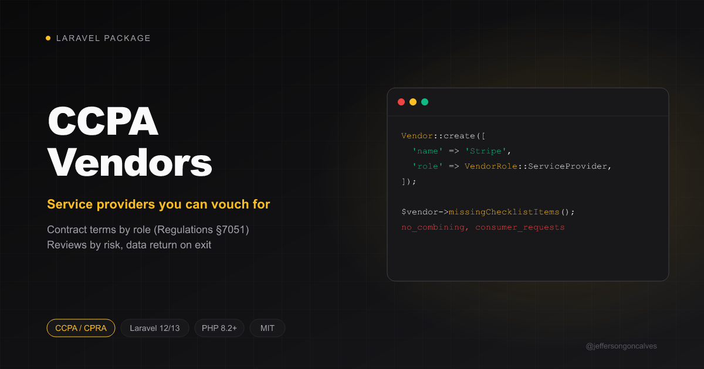

# Laravel CCPA Vendors



[](https://packagist.org/packages/jeffersongoncalves/laravel-ccpa-vendors)
[](https://github.com/jeffersongoncalves/laravel-ccpa-vendors/actions/workflows/tests.yml)
[](https://packagist.org/packages/jeffersongoncalves/laravel-ccpa-vendors)

A register of the businesses you disclose personal information to, for the California Consumer Privacy Act, as amended by the CPRA. It is part of the [laravel-ccpa](https://github.com/jeffersongoncalves/laravel-ccpa) suite.

Every service provider, contractor and third party you sell or share personal information with needs a written contract with specific terms (Cal. Civ. Code §1798.100(d); CCPA Regulations §§7051 and 7053). Without those terms, a "service provider" is treated as a third party, and the disclosure can count as a sale. For each vendor you record:

- its **role**: service provider, contractor or third party (§1798.140(ag), (j) and (ai));
- the **business purpose** the contract limits the use to;
- a **risk tier**, which sets how often the vendor must be reviewed;
- the **contract**: when it was signed and when it expires, plus a checklist of the terms its role requires;
- when the relationship **ended**, and whether the data was deleted or returned.

Each vendor then tells you what it still owes.

> This package gives you tooling. It does not make you compliant on its own. Your contracts need legal review.

## Installation

```bash
composer require jeffersongoncalves/laravel-ccpa-vendors
php artisan vendor:publish --tag="ccpa-vendors-migrations"
php artisan migrate
php artisan vendor:publish --tag="ccpa-vendors-config"   # optional: contract terms, review intervals
```

## Usage

```php
use JeffersonGoncalves\CcpaVendors\Enums\{VendorRisk, VendorRole};
use JeffersonGoncalves\CcpaVendors\Models\Vendor;

$stripe = Vendor::create([
    'name' => 'Stripe',
    'role' => VendorRole::ServiceProvider,
    'services' => 'Card payments',
    'business_purpose' => 'Process payments for orders',
    'data_categories' => ['name', 'email', 'card data'],
    'risk' => VendorRisk::High,
    'dpa_signed_at' => '2026-01-10',
    'dpa_checklist' => ['no_sale_or_sharing' => true, 'specified_purpose' => true /* ... */],
]);

$stripe->issues();                 // [VendorIssue::AgreementIncomplete, ...]
$stripe->missingChecklistItems();  // ['no_combining', 'consumer_requests', ...]
$stripe->nextReviewAt();           // reviewed_at (or created_at) + review_every[risk]
$stripe->markReviewed();

$stripe->terminate();
$stripe->confirmDataReturned();
```

### Contract terms by role

| Role | Terms |
|---|---|
| Service provider | no selling or sharing, a specified business purpose, no other use or disclosure, no combining with other data, CCPA compliance and the same level of protection, your right to take reasonable steps, notice if it can no longer comply, your right to stop and remediate, subcontractors bound by the same terms, help with consumer requests (Regulations §7051(a)) |
| Contractor | the service provider terms, plus its certification that it understands and will comply (§1798.140(j)) |
| Third party | use limited to the purposes of the sale or sharing, CCPA compliance, your right to take reasonable steps, notice if it can no longer comply, your right to stop and remediate (Regulations §7053) |

Change them in `config/ccpa-vendors.php`.

### Issues

| Issue | When |
|---|---|
| `agreement_missing` | no signed contract |
| `agreement_expired` | `dpa_expires_at` has passed |
| `agreement_incomplete` | the contract misses a term its role requires |
| `review_due` | the last review is older than `review_every` for its risk tier (high: 1 year, medium: 2, low: 3) |
| `data_return_pending` | the vendor was terminated and the data deletion or return is not confirmed |

## Report

```bash
php artisan ccpa:vendors             # every vendor, its next review and its issues
php artisan ccpa:vendors --issues    # only those with issues
php artisan ccpa:vendors --json
```

## Testing

```bash
composer test
```

## Changelog

See [CHANGELOG](CHANGELOG.md).

## License

The MIT License (MIT). See [License File](LICENSE.md).
